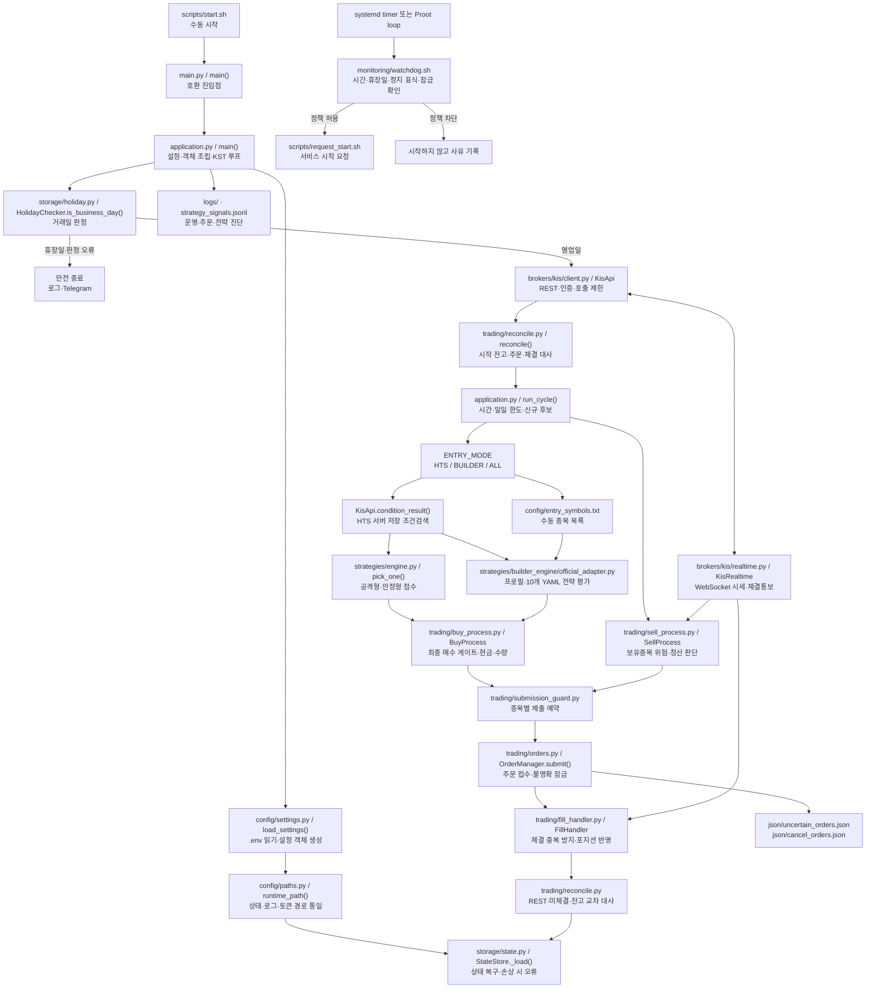

> **역사 문서:** 이 문서는 V7.0.0/V7.0.x 당시 구조를 설명합니다. V7.1.0부터는 공격형/안정형 프로필을 통합했습니다. 현재 운영 기준은 `README.md`와 `docs/operations/V7.1.0_OPERATIONS_MANUAL.md`를 확인하세요.

# KIS Auto Trader V7.0.0 운영 매뉴얼

**문서 성격:** 운영자용 상세 안내서. 설치·시작·정지·감시·전략·주문/체결·대사·장애 복구를 설명합니다. 메소드 명칭은 V7.0.0 배포 소스에서 확인한 이름을 기준으로 합니다.

> **운영 안전 원칙**
> - 초기 및 기본 검증 환경은 `KIS_PAPER=true`, `KIS_ENABLE_TRADING=false`입니다.
> - `KIS_PAPER`는 서버 환경을 선택하고, `KIS_ENABLE_TRADING`은 주문 POST 전송을 허용합니다. 서로 대체하지 못합니다.
> - 테스트 통과는 KIS 서버 E2E, 전략 수익성 또는 실전 투자 적합성 보증이 아닙니다.
> - 주문 결과가 불명확하면 같은 주문을 재전송하지 말고, 불명확 주문 기록을 보존한 뒤 HTS 주문·체결·미체결·잔고와 대조합니다.

## 1. V7.0.0에서 달라진 구조를 이해하기

V7.0.0은 호환 진입점 `main.py`와 실행 조립부 `application.py`를 분리하고, 매수·매도·주문·체결·대사·상태 저장·전략 평가·감시를 별도 모듈로 나눕니다. 이 구조의 목적은 주문 수명주기와 전략 계산을 분리하고, 안전 게이트를 주문 전후에 반복 적용하는 것입니다.

| 영역 | 책임 | 대표 파일 |
|---|---|---|
| 실행 조립 | 설정 읽기, 객체 연결, KST 루프, 종료 순서 | `application.py`, `main.py` |
| 브로커 통신 | 인증, REST, 호출 제한, 실시간 시세/체결통보 | `brokers/kis/client.py`, `brokers/kis/realtime.py` |
| 전략 | 기존 점수 전략과 내부 YAML 전략/프로필 투표 | `strategies/engine.py`, `strategies/builder_engine/` |
| 주문 안전 | 후보 게이트, 제출 잠금, 주문 상태, 체결, 대사 | `trading/`, `risk/` |
| 영속 상태 | 포지션·쿨다운·일일 카운터, 로그 및 미확정 주문 기록 | `storage/`, `json/`, `logs/` |
| 운영 감시 | 예약 시작, watchdog, 수동 정지, 서비스 상태 확인 | `scripts/`, `monitoring/`, `deploy/systemd/` |

전체 흐름도는 [`V7.0.0_SYSTEM_FLOW.md`](../architecture/V7.0.0_SYSTEM_FLOW.md), 복사 가능한 원본은 [`V7.0.0_SYSTEM_FLOW.mmd`](../architecture/V7.0.0_SYSTEM_FLOW.mmd)입니다.

## 2. 전체 실행 및 매매 흐름

1. `scripts/start.sh` 또는 예약 서비스가 시작 경로를 호출합니다.
2. `main.py:main()`은 기존 실행 호환성을 유지하고 `application.py:main()`으로 전달합니다.
3. `config/settings.py:load_settings()`가 `.env`를 읽고 `config/paths.py`가 런타임 파일 위치를 결정합니다.
4. `storage/state.py:StateStore`가 기존 포지션·쿨다운·일일 상태를 복원합니다. 손상 상태를 빈 상태로 조용히 덮어쓰지 않는 것이 원칙입니다.
5. `storage/holiday.py:HolidayChecker.is_business_day()`가 거래일을 확인합니다. 휴장일이거나 판정할 수 없으면 안전하게 진행을 막습니다.
6. `brokers/kis/client.py:KisApi`가 REST 통신을 준비하고 `brokers/kis/realtime.py:KisRealtime`가 WebSocket 시세와 체결통보를 수신합니다.
7. `trading/reconcile.py:reconcile()`가 브로커 잔고·당일 주문·미체결을 로컬 상태와 대조합니다. 안전 대사가 끝나지 않으면 신규 매수를 허용하지 않습니다.
8. `application.py:run_cycle()`이 거래 시간, 일일 거래 한도, 손실 제한, 후보 검색 시점을 판단합니다.
9. `ENTRY_MODE`에 따라 HTS 조건검색, 내부 YAML Builder, 또는 두 경로를 사용합니다. `ALL` 모드에서 HTS 점수와 Builder 점수를 단순 숫자로 비교하지 않으며, Builder 경로가 최종 후보 선택을 담당합니다.
10. `trading/buy_process.py:BuyProcess`가 후보를 검증하고 주문 직전 시세·현금·예약액·수량을 확인합니다.
11. `trading/submission_guard.py:SymbolSubmissionGuard`가 종목별 제출 경합을 막고, `trading/orders.py:OrderManager.submit()`이 주문을 제출·추적합니다.
12. 체결통보는 `trading/fill_handler.py:FillHandler`로 전달되고, 주문/체결/잔고는 REST 대사로 재확인됩니다.
13. 보유 포지션은 `trading/sell_process.py:SellProcess`가 최신 시세, 하드 위험 규칙, YAML 청산 신호를 평가합니다. 매수와 매도는 같은 `OrderManager`를 사용합니다.
14. 종료 시 미체결 취소 확인과 최종 대사가 실행됩니다. 미확정 상태가 남으면 기록을 보존합니다.

## 3. 설치 및 첫 실행

### 3.1 압축 해제 및 기본 검사

```bash
unzip kis_auto_trader_v7_0_0.zip -d kis_auto_trader_v7_0_0
cd kis_auto_trader_v7_0_0
chmod +x scripts/*.sh monitoring/*.sh tests/kis_strategy_test.sh
./scripts/setup.sh
```

설치 시 `.env`가 없으면 `.env.example`을 복사하고 종료 코드 2로 안전하게 멈춥니다. 이는 오류로 무시하고 넘어갈 상황이 아니라, 자격증명과 안전 설정을 운영자가 확인하도록 하는 절차입니다.

### 3.2 `.env` 작성

`.env.example`을 참고해 모의투자용 키와 계좌 설정을 입력합니다. 예제 자리표시자를 실제 모의투자 자격증명으로 바꿉니다. 비밀정보를 채팅, 로그, Git 저장소, 공유 파일에 넣지 않습니다.

최소 확인값:

```dotenv
KIS_PAPER=true
KIS_ENABLE_TRADING=false
KIS_ACNT_PRDT_CD=01
ENTRY_MODE=ALL
MAX_TRADES_PER_DAY=5
MAX_DAILY_LOSS_PCT=2.0
```

`KIS_ENABLE_TRADING=false`는 주문 POST를 차단하는 DRY-RUN입니다. 신호와 계산 로그를 검토하기 위한 기본 상태로 유지합니다.

### 3.3 설치 검사 재실행

```bash
./scripts/setup.sh
source .venv/bin/activate
python -m compileall -q .
pytest -q
python smoke_test.py
./tests/kis_strategy_test.sh --offline --sample-size 10 --seed 42
```

`.env` 작성 후 `setup.sh`를 다시 실행하면 검사와 감시 설치/활성화가 진행될 수 있고, 거래 가능 시간에는 DRY-RUN 프로세스가 시작될 수 있습니다. 실행 전 현재 `.env`, 프로세스, 타이머 상태를 확인합니다. 위 오프라인 전략 테스트는 합성 데이터 기반이며 KIS 인증·주문을 사용하지 않습니다.

## 4. 시작·정지·감시 제어

| 작업 | 명령 | 동작 및 주의 |
|---|---|---|
| 매매 시작 | `./scripts/start.sh` | 매매 프로세스 시작 요청. 설정/수동정지 표식/잠금 상태를 확인합니다. |
| 매매 정지 | `./scripts/stop.sh` | 매매 프로세스를 정지하고 수동 정지 표식을 남겨 watchdog의 당일 자동 재시작을 억제합니다. |
| 감시 시작/재개 | `./scripts/start_monitoring.sh` | systemd timer 또는 Proot 감시 경로를 설치·활성화합니다. 실제 매매 주문 활성화와는 다른 작업입니다. |
| 감시 정지 | `./scripts/stop_monitoring.sh` | 감시를 끕니다. 매매 서비스 자체가 별도 절차 없이 자동 정지되는 것은 아닙니다. |
| 설정만 검증 | `./scripts/reload_config.sh --validate-only` | 설정을 검증하고 매매를 재시작하지 않습니다. |
| 설정 재적용 | `./scripts/reload_config.sh` | 실행 중인 프로세스에 설정을 안전하게 재적용하는 절차입니다. |
| 명시적 재시작 | `./scripts/reload_config.sh --start` | 수동 정지 표식 상태에서 명시적으로 재개할 때 사용합니다. |

### systemd 상태 확인

```bash
systemctl list-timers --all | grep kis-auto-trader
systemctl status kis-auto-trader.service --no-pager
systemctl status kis-auto-trader-start.timer kis-auto-trader-watchdog.timer --no-pager
journalctl -u kis-auto-trader.service -n 200 --no-pager
journalctl -u kis-auto-trader-watchdog.service -n 100 --no-pager
```

- `kis-auto-trader.service`는 매매 프로세스이며 `Restart=no`가 기본 정책입니다.
- `kis-auto-trader-start.timer`는 평일 시작 검사를 예약합니다. 설치된 unit의 실제 시간은 `systemctl list-timers --all`에서 확인합니다.
- `kis-auto-trader-watchdog.timer`는 주기적으로 watchdog을 호출합니다. oneshot인 watchdog service가 한 번 실행된 후 `inactive (dead)`로 표시될 수 있으며, 타이머가 `active (waiting)`인지 별도로 확인해야 합니다.
- `scripts/stop.sh`의 매매 수동 정지 표식과 `scripts/stop_monitoring.sh`의 감시 중지 표식은 서로 다른 제어입니다.
- `deploy/systemd/*.service`의 `/path/to/project`는 템플릿 자리표시자입니다. 직접 복사해 쓰지 말고 `scripts/start_monitoring.sh`를 통해 현재 설치 경로로 생성합니다.

## 5. 주문·체결·대사 수명주기

### 5.1 주문 제출 전

- 최신 시세가 `QUOTE_STALE_SEC` 기준 안에 있는지 확인합니다. 캐시 시세가 오래되면 REST fallback을 사용하되, fallback 간격 제한을 둡니다.
- 종목이 이미 보유 중인지, 동일 종목에 미체결/불명확 주문이 있는지 확인합니다. 추가매수는 명시 설정이 허용하지 않는 한 차단합니다.
- 계좌 잔고 및 미체결 대사가 성공했는지 확인합니다. 확인 실패 시 신규 매수는 안전하게 막습니다.
- 주문가능금액, 기존 매수 예약액, 가격 여유율 및 비용을 반영해 수량을 산정합니다. 고정 수량 설정도 현금 검증을 우회하지 않습니다.

### 5.2 주문 접수 결과가 불명확한 경우

`trading/orders.py:OrderManager.submit()`에서 POST 응답 타임아웃 등으로 주문번호가 확정되지 않으면 해당 주문은 `uncertain` 상태로 취급됩니다. 같은 주문을 자동으로 다시 POST하지 않습니다. 종목별 신규 매수는 잠금으로 막고 `json/uncertain_orders.json`에 기록합니다.

운영자 조치:
1. 매매를 추가로 재시작하거나 동일 주문을 재전송하지 않습니다.
2. `json/uncertain_orders.json`, `json/cancel_orders.json`, `logs/`의 시각·종목·매수/매도·수량·오류를 확인합니다.
3. HTS에서 당일 주문·체결·미체결을 확인하고 계좌 잔고와 대조합니다.
4. 상태를 확정할 근거가 없으면 파일을 지우지 않고 잠금을 유지한 채 운영자 확인 절차를 진행합니다.

### 5.3 체결 반영과 REST 대사

- WebSocket 체결통보는 빠른 이벤트 경로이고, REST 주문/체결/잔고는 교차 확인 경로입니다.
- `FillHandler`는 누적 체결량/개별 체결량과 중복 통보를 구분해 이미 반영한 수량을 중복 반영하지 않도록 합니다.
- `OrderManager.sync_open_orders()`와 `sync_order_history()`는 원격 미체결/주문 이력을 로컬 pending 상태와 동기화합니다.
- `trading/reconcile.py:reconcile()`는 잔고와 주문 상태를 함께 확인합니다. 체결통보 하나만 보고 최종 잔고를 단정하지 않습니다.
- 취소 요청 API의 성공 응답만으로 미체결이 사라졌다고 판단하지 않습니다. 후속 조회에서 취소/미체결 상태를 확인합니다.

### 5.4 종료 시

`AUTO_SHUTDOWN_TIME`은 보유 종목을 자동으로 매도하는 시각이 아닙니다. 종료 과정은 신규 판단 종료, 미체결 주문 취소 요청, 제한 시간 동안 상태 재조회, 최종 잔고/주문 대사로 구성됩니다. 취소 확인이나 최종 조회가 실패하면 취소/불명확 기록을 보존하고 운영자가 확인해야 합니다.

## 6. 전략 구조와 지표

### 6.1 후보 입력 모드

| `ENTRY_MODE` | 입력 및 동작 |
|---|---|
| `HTS` | `KIS_CONDITION_AGGRESSIVE`, `KIS_CONDITION_STABLE`에 지정한 HTS 서버 저장 조건검색을 사용합니다. 조건명은 HTS 저장 이름과 정확히 일치해야 합니다. |
| `BUILDER` | `config/entry_symbols.txt` 및 지정된 종목을 내부 YAML 전략 엔진으로 평가합니다. YAML 모드에서는 스타일 교대가 안정형 프로필로 고정됩니다. |
| `ALL` | HTS 결과를 내부 전략 평가에 추가 후보로 전달하고 Builder 결과로 최종 선택합니다. HTS 점수와 Builder 점수는 척도가 다르므로 단순 숫자 비교를 하지 않습니다. |

### 6.2 기존 점수 엔진

`strategies/engine.py:StrategyEngine`은 `_score_aggressive()`, `_score_stable()`, `score()`, `pick_one()`을 통해 기존 공격형/안정형 후보 점수를 계산합니다. `_anti_chase()`는 급등 추격 매수 억제에 관여하고 `exit_signal()`은 레거시 손절/익절/트레일링 청산 판단을 제공합니다.

`.env.example` 예시 기준으로 공격형/안정형은 다음처럼 구성됩니다. 이는 성과 보장값이 아니라 조정 가능한 정책 예시입니다.

| 설정 | 공격형 예시 | 안정형 예시 | 의미 |
|---|---:|---:|---|
| 최소 점수 | `AGG_MIN_SCORE=72` | `STABLE_MIN_SCORE=78` | 후보 선택 하한 |
| 추격 차단 | `AGG_MAX_CHASE_PCT=4.0` | `STABLE_MAX_CHASE_PCT=2.0` | 기준 변동률을 초과하는 급등 추격 억제 |
| 손절 | `AGG_STOP_LOSS_PCT=2.0` | `STABLE_STOP_LOSS_PCT=1.5` | 평균매입가 대비 손실 제한 신호 |
| 익절 | `AGG_TAKE_PROFIT_PCT=4.5` | `STABLE_TAKE_PROFIT_PCT=3.0` | 평균매입가 대비 이익 실현 신호 |
| 트레일링 시작 | `AGG_TRAILING_START_PCT=2.5` | `STABLE_TRAILING_START_PCT=1.8` | 트레일링 평가를 시작할 수익률 |
| 트레일링 간격 | `AGG_TRAILING_GAP_PCT=1.5` | `STABLE_TRAILING_GAP_PCT=1.0` | 고점 대비 허용 하락폭 |
| 청산 후 대기 | `AGG_COOLDOWN_SEC=900` | `STABLE_COOLDOWN_SEC=1800` | 같은 종목 재진입 전 대기시간 |
| 포지션 비중 상한 | `AGG_MAX_POSITION_RATIO=0.20` | `STABLE_MAX_POSITION_RATIO=0.15` | 자금 대비 단일 포지션 비중 제한 예시 |

### 6.3 V7.0.0 내부 YAML 전략 10개

전략 정의는 `config/strategies/`에 있으며, 실행/투표 설정은 `config/strategy_profiles.yaml`에서 관리합니다. 파일의 `enabled`는 전략 파일을 사용할지, 프로필의 `decision_enabled`는 자동 의사결정 투표에 반영할지를 구분합니다. `enabled: true`라고 해서 모든 전략이 모든 회차에서 자동 투표한다는 뜻은 아닙니다.

| ID | 파일 | 전략 개념 | 운영상 확인 |
|---|---|---|---|
| `golden_cross` | `strategy_01_golden_cross.kis.yaml` | 단기·장기 이동평균 골든크로스 계열 | 안정형 프로필의 primary 전략 |
| `momentum` | `strategy_02_momentum.kis.yaml` | 가격 모멘텀 및 추세 지속 | 공격형 프로필의 primary 전략 |
| `week52_high` | `strategy_03_week52_high.kis.yaml` | 52주 고점/돌파 성격 | 급등·과열 및 데이터 기간 점검 |
| `consecutive` | `strategy_04_consecutive.kis.yaml` | 연속 상승/하락 흐름 | 연속 기간과 신호 기준 확인 |
| `disparity` | `strategy_05_disparity.kis.yaml` | 이동평균 이격도 | 과도한 이격/평균 회귀 위험 확인 |
| `breakout_fail` | `strategy_06_breakout_fail.kis.yaml` | 돌파 실패/되돌림 위험 | 추격 진입 차단 보조 신호로 해석 |
| `strong_close` | `strategy_07_strong_close.kis.yaml` | 종가 강도 | 종가 위치/당일 데이터 품질 확인 |
| `volatility` | `strategy_08_volatility.kis.yaml` | 변동성 기반 신호 | 변동성 급증과 위험 확대에 주의 |
| `mean_reversion` | `strategy_09_mean_reversion.kis.yaml` | 평균 회귀 | 프로필 설정상 안정형의 자동 의사결정 비활성 예시 |
| `trend_filter` | `strategy_10_trend_filter.kis.yaml` | 추세 필터 | 안정형 프로필의 추세 확인 전략 |

### 6.4 프로필 투표 예시

`config/strategy_profiles.yaml` 기준:
- **aggressive:** 최소 BUY 점수 50, 최소 BUY 투표 2, primary BUY 필수. `momentum`이 primary이고 위험 원천 전략입니다. `week52_high`, `strong_close`, `volatility`도 투표 전략으로 설정되어 있습니다.
- **stable:** 최소 BUY 점수 55, 최소 BUY 투표 2, primary BUY 필수. `golden_cross`가 primary 및 위험 원천 전략이고 `trend_filter`, `consecutive`가 투표에 참여합니다. `mean_reversion`은 파일은 활성화되어 있어도 `decision_enabled: false`로 자동 투표에서 제외된 설정 예시입니다.
- 두 프로필의 SELL은 최소 1표, 최소 SELL 점수 20, primary SELL 필수 아님으로 설정된 예시입니다.
- 실제 판정은 YAML 조건, 데이터 유효성, 각 전략의 활성/투표 설정, 점수·표 수를 함께 따릅니다. 설정을 변경한 뒤 오프라인 테스트와 신호 로그를 검토합니다.

### 6.5 지표 및 데이터 주의

내부 YAML 엔진은 정의된 지표/조건 DSL의 지원 부분집합만 처리합니다. 지원되지 않는 연산자/조건은 정상 BUY/SELL 신호로 간주하지 않고 오류 결과로 분리합니다. 전략 이름만 보고 외부 Builder의 모든 DSL이 지원된다고 가정하지 않습니다. 내부 엔진의 계산 결과는 `strategy_signals.jsonl`에서 전략 ID, 종목, 목적, 결과, 사유를 확인합니다.

## 7. 주요 파일·클래스·메소드 상세 지도

| 파일 / 심볼 | 주요 메소드 | 기능·호출 경계 |
|---|---|---|
| `main.py` | `main()` | 기존 명령/실행 경로 호환용 진입점. 핵심 실행 로직을 `application.py`에 위임합니다. |
| `application.py` | `_configure_logging()`, `run_cycle()`, `run_builder_cycle()`, `_position_strategy_risk_exit()`, `_apply_fill()`, `log_portfolio_snapshot()`, `main()` | 로깅 구성, HTS/Builder 회차, 청산 위험 우선순위, 체결 후 상태 적용, 자산 요약, 객체 생성·이벤트 연결·KST 루프·종료 대사를 담당합니다. |
| `config/settings.py` | `_bool()`, `_int()`, `_float()`, `load_settings()` | 환경변수 타입 변환 및 `Settings`/`StrategyConfig` 생성. 범위가 제한된 설정은 안전한 범위로 제한합니다. |
| `config/paths.py` | `runtime_path()` 및 경로 매핑 | 런타임 데이터/로그 경로를 프로젝트 루트 기준으로 통합합니다. 경로 변경은 기존 데이터의 자동 이전을 뜻하지 않습니다. |
| `brokers/kis/client.py` | `KisApi._request()`, `ensure_token()`, `issue_ws_approval_key()`, `condition_titles()`, `condition_result()`, `find_condition_seq()`, `current_price()`, `daily_prices()`, `order_cash()`, `cancel_order()`, `orderable_cash()`, `balance()`, `daily_orders()` | KIS 인증/REST 호출/호출 제한/조건검색/시세/일봉/주문/취소/주문가능금액/잔고/당일 주문 조회. 불명확한 주문 POST는 자동 재전송하지 않는 경계를 둡니다. |
| `brokers/kis/realtime.py` | `KisRealtime.set_candidate_symbols()`, `set_held_symbols()`, `subscribe_symbols()`, `start_background()`, `_receive_loop()`, `stop()` | 실시간 가격 및 주문체결 통보 구독/수신. 이벤트는 빠른 처리 경로이며 최종 정합성은 REST 대사로 확인합니다. |
| `strategies/engine.py` | `StrategyEngine._common_metrics()`, `_anti_chase()`, `_score_aggressive()`, `_score_stable()`, `score()`, `pick_one()`, `exit_signal()` | 레거시 점수 기반 공격형/안정형 후보 순위, 급등 추격 억제, 기본 청산 신호를 계산합니다. |
| `strategies/builder_engine/internal_engine.py` | `_bars()`, `_sma()`, `_cross_up()`, `_cross_down()`, `_yaml_values()`, `_yaml_group()`, `evaluate_strategy()`, `evaluate_custom()` | 일봉 정규화, 지표/조건 평가, YAML 전략 평가. 잘못되거나 미지원인 DSL을 오류로 구분합니다. |
| `strategies/builder_engine/official_adapter.py` | `yaml_to_builder_state()`, `OfficialBuilderAdapter.load_profiles()`, `evaluate()`, `get_profile_risk()` | 프로필과 전략 파일을 읽고 파라미터를 적용, 전략 결과를 집계하고 JSONL 진단 로그를 기록합니다. V7.0.0에서는 외부 Builder 서버를 호출하지 않습니다. |
| `strategies/builder_engine/yaml_engine.py` | `YamlStrategyEngine.load()`, `evaluate()`, `_normalise_bars()`, `_indicators()`, `_resolve()`, `_evaluate_group()`, `evaluate_position_risk()` | 사용자 지정 진입/청산 YAML의 지원 부분집합을 평가하고 보유 포지션 위험 사유를 산출합니다. |
| `trading/buy_process.py` | `BuyProcess.select_candidate()`, `validate_candidate()`, `prepare_candidate_order()`, `submit_candidate_order()` | ENTRY_MODE별 후보 선택, 보유/미체결/계좌 대사 게이트, 최신 시세/주문 방식/현금/수량 검증, 공통 주문 관리자 제출을 단계별로 수행합니다. |
| `trading/sell_process.py` | `SellProcess.process_positions()`, `event_exit_worker()` | 보유 종목의 최신 시세를 확보하고 위험·YAML 청산을 평가하며 이벤트 청산 작업을 처리합니다. 주문 상태 관리는 `OrderManager`에 위임합니다. |
| `trading/orders.py` | `OrderManager.request_cancel()`, `reconcile_uncertain_orders()`, `archive_and_clear_uncertain_orders()`, `pending_buy_symbols()`, `pending_buy_reservation()`, `submit()`, `on_notice()`, `timed_out()`, `sync_open_orders()`, `sync_order_history()` | 주문 상태 머신, 취소 감사, 불명확 주문 잠금/대사, 매수 예약액, POST, 체결통보 처리, 타임아웃 및 원격 주문 동기화. 잠금 해제/기록 초기화는 최종 확인 근거가 필요합니다. |
| `trading/fill_handler.py` | `apply_fill_state()`, `FillHandler.apply_fill_event()` | 누적/개별 체결 수량과 중복 이벤트를 처리해 실제 체결량만 상태에 반영합니다. |
| `trading/reconcile.py` | `reconcile()`, `reconcile_open_orders()`, `cancel_all_open_orders()` | 잔고·당일 주문·미체결을 대사하고, 종료 시 미체결 취소 및 최종 확인을 수행합니다. |
| `trading/submission_guard.py` | `SymbolSubmissionGuard.reserve()`, `release()`, `is_reserved()` | 같은 종목에 동시 주문 제출이 겹치지 않도록 임시 예약을 관리합니다. |
| `risk/position_sizer.py` | `calculate_buy_qty()` | 주문가능현금, 보유 수, 가격/비용 여유 및 예약액에 따라 주문 수량을 산정합니다. |
| `storage/state.py` | `StateStore._load()`, `save()`, `reset_daily_if_needed()`, `set_position()`, `increment_trade_count()`, `add_realized_pnl_krw()`, `daily_loss_pct()`, `cooldown_active()`, `mark_exit_cooldown()` | 포지션/일일 손익/거래 수/쿨다운을 영속화합니다. 복구 오류는 운영자 확인이 필요한 오류로 취급합니다. |
| `storage/holiday.py` | `HolidayChecker._paper_business_day()`, `is_business_day()` | 모의투자/거래일 달력과 KIS 조회를 이용해 영업일을 판정합니다. 판정 실패 시 신규 시작을 안전하게 차단합니다. |
| `storage/daily_logging.py` | 날짜별 로깅 구성 함수 | KST 날짜별 로그 파일과 로그 경로를 구성합니다. |
| `notifications/telegram.py` | `TelegramNotifier.send()` 및 초기화 메소드 | 설정이 완료된 경우 시작/오류/불명확 주문 등 운영 알림을 보냅니다. Telegram은 HTS 확인을 대체하지 않습니다. |
| `monitoring/healthcheck.py` | `main()` | 프로세스와 로그 갱신 등 기본 건강 상태를 점검합니다. |
| `monitoring/watchdog.sh` | watchdog 스크립트 본문 | 시간/주말/휴장일/수동 정지/잠금 조건을 확인해 시작 요청을 허용하거나 차단합니다. |
| `monitoring/monitor_loop.sh` | 감시 반복 루프 | systemd가 없는 환경에서 주기 감시를 실행하며 cutoff 이후 다음 거래일 검사도 유지합니다. |
| `scripts/request_start.sh` | 스크립트 본문 | 시작 직전에 운영 정책을 다시 확인하고 systemd 서비스 시작을 요청합니다. |
| `scripts/start_monitoring.sh`, `stop_monitoring.sh` | 스크립트 본문 | 감시 timer/loop를 설치·활성화하거나 감시 중지 표식을 기록합니다. 매매 서비스 정지와 혼동하지 않습니다. |
| `scripts/upgrade_migrate.py` | `migrate()`, `_build_items()`, `_validate_data()`, `_atomic_write()`, `_make_backup()`, `main()` | 기존 운영 파일 사전검사, 충돌 확인, 백업, 원자 복사, 해시/JSON 검증을 수행합니다. 원본을 자동 삭제하지 않습니다. |
| `scripts/reload_config.sh` | 스크립트 본문 | 설정 검증과 실행 중 설정 재적용을 처리합니다. `--start`는 명시적으로 재개를 요청하는 별도 옵션입니다. |

## 8. 런타임 데이터와 로그 파일

| 경로/파일 | 용도 | 운영 규칙 |
|---|---|---|
| `.env` | 인증/계좌/실행/전략 설정 | 비밀정보 포함. 백업은 안전한 위치에, 외부 공유/커밋 금지. |
| `json/state.json` 또는 설정 경로 | 포지션, 평균단가, 수량, 손익, 쿨다운, 일일 카운터 | 손상 시 삭제해 초기화하지 않습니다. 원본을 복사해 보존하고 JSON 구문/백업/HTS 잔고를 확인합니다. |
| `json/uncertain_orders.json` | 주문 접수 여부 불명확한 주문의 잠금/감사 기록 | HTS 당일 주문·체결·미체결·잔고 확인 전 삭제 금지. |
| `json/cancel_orders.json` | 원주문별 취소 요청/응답/후속 확인 기록 | 취소 응답과 실제 미체결 해소는 구분합니다. 업데이트 전 백업합니다. |
| `json/kis_tokens.json` 등 토큰 캐시 | API 인증 토큰/승인키 캐시 | 비밀정보로 취급합니다. 로그/공유/커밋 금지. |
| `logs/` | 일자별 운영·주문·오류·제어·감시 로그 | 시간대, 종목, 주문번호를 함께 확인합니다. 로그는 공식 브로커 주문 내역의 대체물이 아닙니다. |
| `strategy_signals.jsonl` | 전략 ID/종목/BUY·HOLD·SELL·ERROR/사유 진단 | 후보가 선택되지 않은 이유와 전략 간 투표 결과를 확인합니다. |
| `config/krx_holidays_2026.json` 등 | 휴장일 달력 | 해당 연도와 형식을 확인하고, 파일 누락/판정 실패 시 억지로 실행하지 않습니다. |

실제 경로는 `config/paths.py` 및 `.env`의 경로 설정에 따라 달라질 수 있습니다. 경로 설정을 변경해도 기존 상태 파일이 자동으로 새 위치로 이동하는 것은 아닙니다.

## 9. 장애 대응 절차

### 9.1 프로그램이 시작되지 않음

```bash
./scripts/reload_config.sh --validate-only
python monitoring/healthcheck.py
journalctl -u kis-auto-trader.service -n 200 --no-pager
```

확인 순서: `.env` 존재/자리표시자 → 모의투자 API 키와 endpoint 일치 → 파일 권한/가상환경 → 상태 JSON 복구 오류 → 휴장일 달력 → 기존 V5/V6 프로세스나 timer 중복 → 수동 정지/감시 중지 표식 → 로그의 최초 오류. 검증을 위해 운영 상태 파일을 지우지 않습니다.

### 9.2 매수 후보가 나오지 않음

1. `ENTRY_MODE`와 `KIS_CONDITION_AGGRESSIVE`/`KIS_CONDITION_STABLE`을 확인합니다.
2. HTS 조건명이 서버에 저장된 이름과 정확히 일치하는지 확인합니다.
3. `strategy_signals.jsonl`에서 각 전략의 `HOLD`/`ERROR` 사유, 최소 점수/투표/primary 전략 조건을 확인합니다.
4. 보유 종목, pending/uncertain 주문, 쿨다운, 계좌/미체결 대사 상태, 최신 시세, 거래 시간 및 일일 한도를 확인합니다.
5. 일봉 데이터가 부족하거나 DSL이 미지원이면 전략 결과가 정상 BUY가 되지 않을 수 있습니다. 조건을 무작정 완화하지 말고 원인부터 확인합니다.

### 9.3 주문 결과가 불명확하거나 체결/잔고가 다름

1. 같은 주문을 재전송하지 않습니다.
2. 로그와 `uncertain_orders.json`/`cancel_orders.json`을 복사해 보존합니다.
3. HTS에서 당일 주문·체결·미체결을 확인하고 KIS 잔고와 대조합니다.
4. 부분체결 여부, 원주문번호/취소 주문번호, 잔여 수량을 구분합니다.
5. 확실한 근거 없이 pending/uncertain 잠금을 수동 해제하지 않습니다.

### 9.4 watchdog이 재시작하지 않음

```bash
systemctl list-timers --all | grep kis-auto-trader
systemctl status kis-auto-trader-start.timer kis-auto-trader-watchdog.timer --no-pager
journalctl -u kis-auto-trader-watchdog.service -n 100 --no-pager
cat json/manual_stop.json 2>/dev/null
cat json/monitoring_disabled.json 2>/dev/null
```

수동 정지 표식은 재시작 억제를 위한 의도된 보호입니다. 재개는 `./scripts/start.sh` 또는 필요한 경우 `./scripts/reload_config.sh --start`로 명시적으로 요청합니다. 감시가 꺼졌다면 `./scripts/start_monitoring.sh`를 사용합니다. 표식을 임의 삭제해 우회하지 않습니다.

### 9.5 종료 시 미체결/취소 확인이 끝나지 않음

`cancel_orders.json` 및 `uncertain_orders.json`을 보존하고 HTS의 미체결 목록을 확인합니다. 취소 API 응답 성공만으로 미체결 종료를 가정하지 않습니다. 종료 후에도 기록이 남는 것은 최종 확인 실패를 나타낼 수 있는 안전 동작입니다.

## 10. 모의투자 검증 체크리스트

### 환경/시작
- [ ] `KIS_PAPER=true`, `KIS_ENABLE_TRADING=false`를 확인합니다.
- [ ] `.env`의 계좌/앱키/상품코드가 모의투자 계정과 일치합니다.
- [ ] `pytest -q`, `python smoke_test.py`, compileall, 오프라인 전략 테스트가 통과합니다.
- [ ] 휴장일 확인, WebSocket 연결/종목 구독, 로그 기록, Telegram(설정 시) 알림을 확인합니다.
- [ ] systemd timer가 실행 중인지, 매매 서비스가 중복 실행되지 않는지 확인합니다.

### 후보/매수 게이트
- [ ] HTS 조건명/ENTRY_MODE와 Builder 종목 입력 파일을 확인합니다.
- [ ] 전략별 신호/점수/투표/거절 사유가 `strategy_signals.jsonl`에 남습니다.
- [ ] 오래된 시세, REST fallback 제한, 가격 급등 추격 차단을 확인합니다.
- [ ] 이미 보유한 종목 및 pending/uncertain 주문이 중복 매수되지 않습니다.
- [ ] 잔고/미체결 대사 실패, 주문가능현금 누락, 수량 계산 오류가 신규 매수를 차단합니다.
- [ ] 일일 매수 횟수 제한 및 일일 손실 제한의 실제 계산 기준을 확인합니다.

### 주문/체결/복구
- [ ] 주문 접수, 미체결, 부분체결, 전량체결 상태가 로그와 HTS에서 일치합니다.
- [ ] 누적/중복 체결통보가 포지션 수량에 중복 반영되지 않습니다.
- [ ] 타임아웃 후 취소는 미체결 목록 재조회로 확인합니다.
- [ ] 불명확 주문은 재전송되지 않고 잠금/감사 파일에 남습니다.
- [ ] 재시작 후 브로커 잔고와 로컬 포지션 대사가 수행됩니다.
- [ ] 매도 주문/부분체결/잔여 수량/청산 후 쿨다운을 확인합니다.

### 종료/감시
- [ ] 테스트 환경에서 `AUTO_SHUTDOWN_TIME`을 조정해 종료 순서를 확인합니다.
- [ ] 미체결 전체 취소, 재조회 간격/최대 대기시간, 최종 대사 성공·실패 분기를 확인합니다.
- [ ] 최종 확인 실패 시 취소/불명확 기록이 보존됩니다.
- [ ] `stop.sh` 후 watchdog이 수동 정지를 존중하고, 명시적 시작 요청 때만 재개합니다.
- [ ] `stop_monitoring.sh`와 `stop.sh`의 차이를 확인합니다.

## 11. 실전 전 필수 주의사항

- `KIS_PAPER=false`는 실전 endpoint를 선택하고, `KIS_ENABLE_TRADING=true`는 주문 POST를 허용합니다. 둘 중 하나만 바꾸는 것도 운영 환경에 영향을 줍니다.
- 실전 전환은 사용자 승인, 모의투자 주문/부분체결/취소/잔고 대사 검증, 장애 복구 리허설, 키/계좌 재확인 이후 별도로 결정해야 합니다.
- 주문 POST 결과가 불명확할 수 있습니다. 이 경우 자동 재전송 금지가 중복 주문 방지의 핵심입니다.
- 시장가/최유리/지정가의 체결 가능성과 가격은 다릅니다. 호가 단위, VI, 거래정지, 가격제한폭, 장 시작/마감 동시호가를 검증해야 합니다.
- `MAX_DAILY_LOSS_PCT`는 프로그램이 정의한 기준에 따라 동작하며 계좌 전체의 손실 한도를 보장하지 않습니다. 수수료·세금·슬리피지·API 지연·거래소 상황도 결과에 영향을 줍니다.
- `AUTO_SHUTDOWN_TIME`은 보유 주식을 자동 매도하지 않습니다.
- Telegram은 운영 알림 채널일 뿐 브로커 공식 기록이나 운영자의 HTS 확인을 대체하지 않습니다.

## 12. 공식 문서와 추가 점검

- 설정 전체: [`CONFIGURATION_REFERENCE.md`](../configuration/CONFIGURATION_REFERENCE.md)
- 시스템 흐름도: [`V7.0.0_SYSTEM_FLOW.md`](../architecture/V7.0.0_SYSTEM_FLOW.md)
- 복사 가능한 Mermaid 원본: [`V7.0.0_SYSTEM_FLOW.mmd`](../architecture/V7.0.0_SYSTEM_FLOW.mmd)
- 내부 전략 엔진: [`V7.0.0_INTERNAL_STRATEGY_ENGINE.md`](../architecture/V7.0.0_INTERNAL_STRATEGY_ENGINE.md)
- 마이그레이션/소스 감사: [`V7.0.0_MIGRATION_AND_SOURCE_AUDIT.md`](../architecture/V7.0.0_MIGRATION_AND_SOURCE_AUDIT.md)
- 테스트 결과: [`V7.0.0_VALIDATION.md`](../validation/V7.0.0_VALIDATION.md)

**문서 한계:** 문서는 소스 구조와 테스트 범위를 설명하며, 실제 KIS 서버의 모든 주문/체결/취소 응답을 통합 검증한 결과가 아닙니다. 자동매매는 우선 DRY-RUN과 모의투자로 충분히 검증하세요.


---

# KIS Auto Trader V7.0.0 — 시스템 전체 흐름도

> 소스 기준: V7.0.0 배포 패키지. 이 다이어그램은 구성요소와 논리 흐름을 설명하며, 스레드/콜백의 모든 시간 순서를 보장하는 시퀀스 다이어그램은 아닙니다.



## 읽는 법
- **위쪽 경로**는 설정과 상태를 복구하고 거래일을 확인한 다음 KIS REST/WebSocket을 준비하는 시작 경로입니다.
- **가운데 경로**는 HTS 또는 내부 YAML 전략으로 후보를 만들고, 매수 전 게이트를 통과한 후보만 공통 주문 관리자에 전달합니다.
- **아래 경로**는 체결통보와 REST 대사를 교차 사용해 포지션/주문 상태를 맞춥니다. 체결통보만으로 모든 상태를 확정하지 않습니다.
- **감시 경로**는 매매 프로세스와 별개입니다. `stop.sh`의 수동 정지 표식은 watchdog 자동 재시작을 억제하며, `stop_monitoring.sh`는 감시 자체를 끕니다.
- `KIS_PAPER=true`는 모의투자 endpoint 선택, `KIS_ENABLE_TRADING=false`는 주문 POST 차단입니다. 두 값은 별개입니다.


---

# KIS Auto Trader V7.0.0 — 파일·메소드 빠른 참조

이 문서는 운영자가 로그/코드를 따라갈 때 사용하는 소스 지도입니다. 메소드 존재 여부는 V7.0.0 소스 트리를 기준으로 확인했습니다. 함수 내부의 세부 실행 순서는 해당 소스와 테스트를 함께 확인해야 합니다.

## 실행/설정

| 파일 | 메소드/심볼 | 설명 |
|---|---|---|
| `main.py` | `main()` | 이전 실행 경로와 호환되는 얇은 진입점 |
| `application.py` | `main()` | 설정 로드, 객체 생성, 이벤트 콜백 연결, 실행/종료 관리 |
| `application.py` | `run_cycle()` | 기존 HTS/점수 엔진 후보 탐색 및 매수/매도 회차 |
| `application.py` | `run_builder_cycle()` | 내부 YAML 전략 후보 평가 및 선택 경로 |
| `application.py` | `_apply_fill()` | 체결 결과를 상태/전략 엔진에 반영 |
| `config/settings.py` | `load_settings()` | `.env` 값을 `Settings` 객체로 변환 |
| `config/paths.py` | `runtime_path()` | 공통 런타임 경로 해석 |

## KIS 연결/실시간

| 파일 | 메소드/심볼 | 설명 |
|---|---|---|
| `brokers/kis/client.py` | `KisApi._request()` | REST 요청 공통 경로, 호출 제한/오류 처리 |
| same | `ensure_token()` | REST 토큰 확보/갱신 |
| same | `issue_ws_approval_key()` | WebSocket 승인키 요청 |
| same | `condition_titles()`, `condition_result()`, `find_condition_seq()` | HTS 저장 조건 목록/결과 조회 |
| same | `current_price()`, `daily_prices()` | 현재가 및 일봉 데이터 조회 |
| same | `order_cash()`, `cancel_order()` | 현금 주문/취소 요청 |
| same | `orderable_cash()`, `balance()`, `daily_orders()` | 주문가능금액/잔고/당일 주문 조회 |
| `brokers/kis/realtime.py` | `start_background()`, `set_candidate_symbols()`, `set_held_symbols()`, `sync_price_subscriptions()`, `_receive_loop()`, `stop()` | WebSocket 생명주기, 종목 구독, 시세/체결통보 수신 |

## 전략

| 파일 | 메소드/심볼 | 설명 |
|---|---|---|
| `strategies/engine.py` | `_score_aggressive()`, `_score_stable()`, `score()`, `pick_one()` | 기존 공격형/안정형 점수 및 후보 선택 |
| same | `_anti_chase()`, `exit_signal()` | 급등 추격 억제 및 레거시 청산 판단 |
| `strategies/builder_engine/internal_engine.py` | `evaluate_strategy()`, `evaluate_custom()` | 내부 YAML 전략 및 사용자 정의 조건 평가 |
| same | `_yaml_values()`, `_yaml_group()`, `_sma()`, `_cross_up()`, `_cross_down()` | 지표 계산과 YAML 조건 그룹 평가 |
| `strategies/builder_engine/official_adapter.py` | `OfficialBuilderAdapter.load_profiles()`, `evaluate()`, `get_profile_risk()` | 프로필/전략 로드, 결과 집계, 위험 설정 조회 |
| same | `yaml_to_builder_state()` | YAML 조건을 내부 평가 상태로 변환 |
| `strategies/builder_engine/yaml_engine.py` | `load()`, `evaluate()`, `_indicators()`, `_evaluate_group()`, `evaluate_position_risk()` | 사용자 진입/청산 YAML 평가 |

## 주문/체결/위험/상태

| 파일 | 메소드/심볼 | 설명 |
|---|---|---|
| `trading/buy_process.py` | `select_candidate()`, `validate_candidate()`, `prepare_candidate_order()`, `submit_candidate_order()` | 후보 선택→안전 게이트→최신 시세/현금/수량→제출 |
| `trading/sell_process.py` | `process_positions()`, `event_exit_worker()` | 보유종목 청산 판단 및 이벤트 작업 |
| `trading/orders.py` | `OrderManager.submit()`, `on_notice()`, `timed_out()` | 주문 제출/체결통보/타임아웃 관리 |
| same | `request_cancel()`, `sync_open_orders()`, `sync_order_history()` | 취소 요청 및 원격 주문 동기화 |
| same | `reconcile_uncertain_orders()`, `archive_and_clear_uncertain_orders()` | 불명확 주문 대사, 확인 후 기록 보관/초기화 |
| same | `pending_buy_symbols()`, `pending_buy_reservation()` | 진행 중 매수 및 예약 금액 추적 |
| `trading/fill_handler.py` | `apply_fill_state()`, `FillHandler.apply_fill_event()` | 중복 체결 방지와 실제 체결량 반영 |
| `trading/reconcile.py` | `reconcile()`, `reconcile_open_orders()`, `cancel_all_open_orders()` | 잔고/주문 대사와 종료 시 미체결 취소 확인 |
| `trading/submission_guard.py` | `reserve()`, `release()`, `is_reserved()` | 종목별 동시 제출 잠금 |
| `risk/position_sizer.py` | `calculate_buy_qty()` | 주문가능 현금/예약액/가격 버퍼 기반 수량 계산 |
| `storage/state.py` | `StateStore._load()`, `save()`, `reset_daily_if_needed()`, `daily_loss_pct()`, `cooldown_active()`, `mark_exit_cooldown()` | 상태 복구/저장, 일일 손익 및 재진입 대기 |
| `storage/holiday.py` | `is_business_day()`, `_paper_business_day()` | 거래일/휴장일 판단 |

## 운영 감시/이전

| 파일 | 메소드/심볼 | 설명 |
|---|---|---|
| `monitoring/healthcheck.py` | `main()` | 프로세스/로그 갱신 상태 점검 |
| `monitoring/watchdog.sh` | 스크립트 진입점 | 자동 시작 전 시간/휴장일/정지 표식/잠금 확인 |
| `monitoring/monitor_loop.sh` | 반복 루프 | systemd 없는 환경의 감시 루프 |
| `scripts/upgrade_migrate.py` | `migrate()`, `_build_items()`, `_validate_data()`, `_atomic_write()`, `_make_backup()` | 운영 파일 사전검사·백업·검증·복사 |
| `scripts/reload_config.sh` | 스크립트 진입점 | 설정 검증 및 안전한 재적용/명시적 재시작 |

## 절대 혼동하지 말아야 할 점

- `KIS_PAPER=true`는 모의투자 서버 선택이고 `KIS_ENABLE_TRADING=false`는 주문 POST 차단입니다.
- 불명확 주문은 자동 재전송하지 않습니다. HTS/REST 확인 전 불명확 기록을 삭제하지 않습니다.
- `AUTO_SHUTDOWN_TIME`은 보유 주식 자동 매도 시간이 아닙니다.
- 감시 timer와 매매 service는 별도입니다. `stop_monitoring.sh`는 `stop.sh`와 다릅니다.
